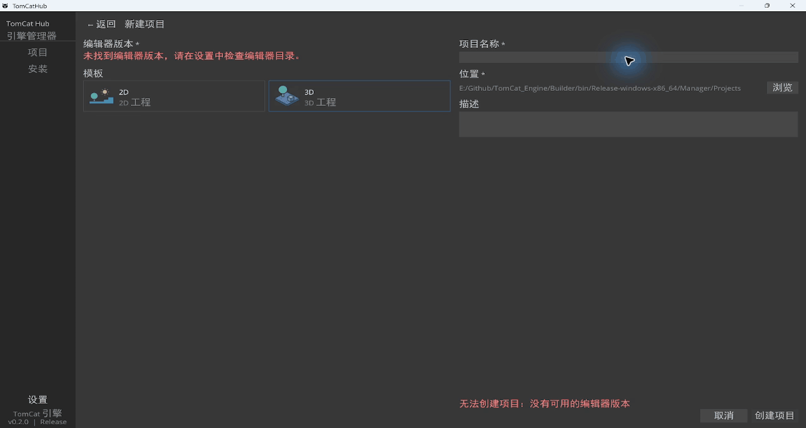
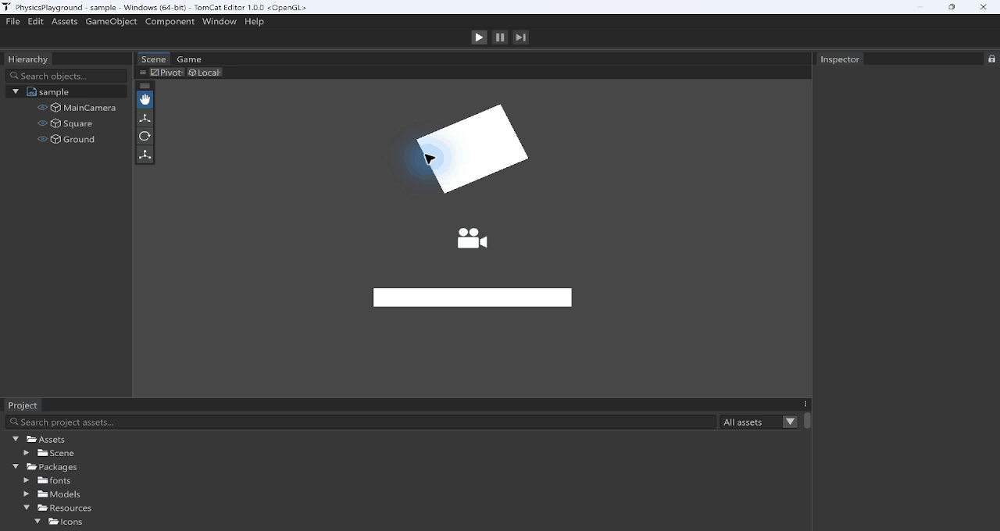
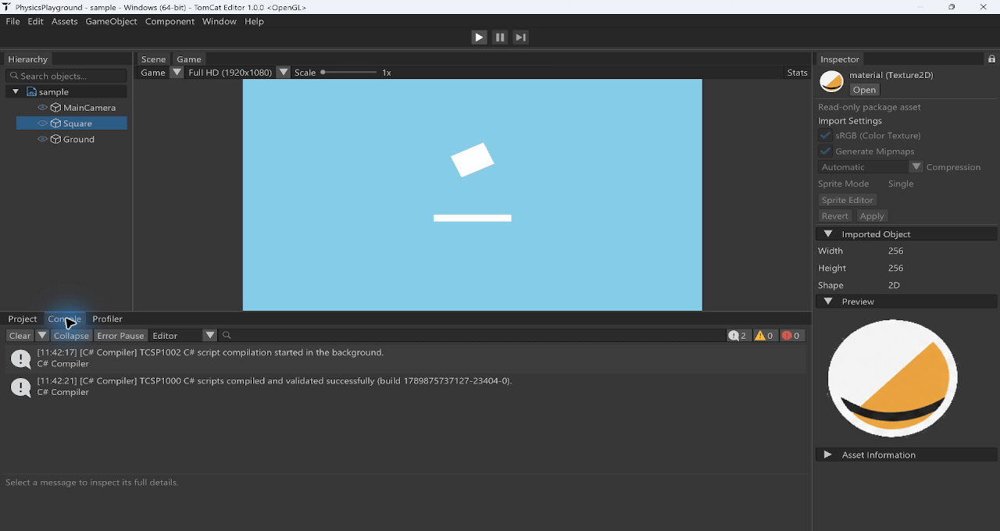
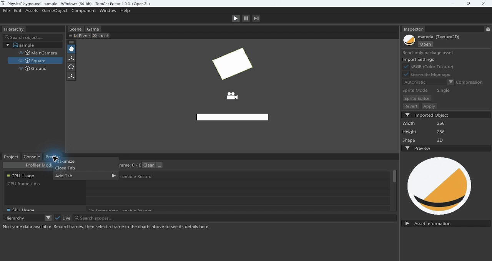
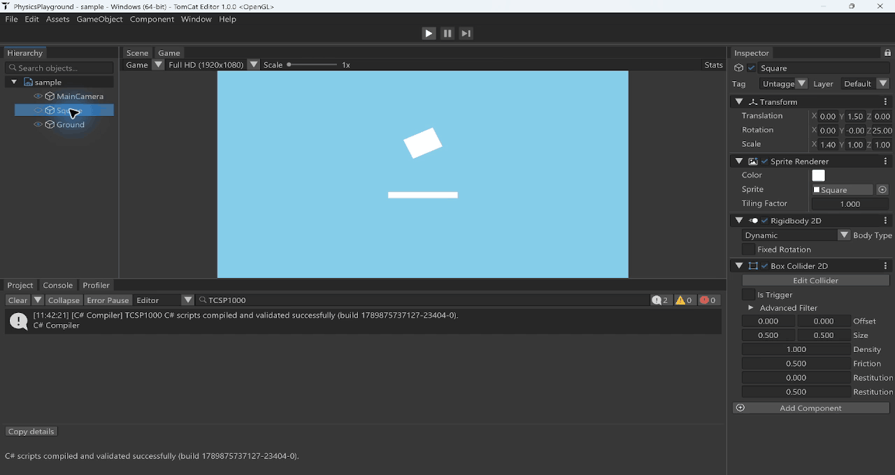

# TomCat Engine

A **C++20 game engine for 2D development**, with a visual editor, a project hub,
and a standalone game runtime.

TomCat brings scene composition, asset management, C# gameplay scripting, and
Box2D physics into one development environment. Its engine library provides the
rendering, ECS scene model, and runtime systems; the Editor exposes those systems
through visual authoring tools, while the Player runs packaged games independently.

**C++20 · OpenGL / Vulkan · ImGui · Box2D · .NET 10 · Windows x64 · MIT**

**Languages**: English | [简体中文](README.zh-CN.md)

## Current Branch Purpose

**main — Desktop mainline and integration baseline**

Use this branch for the Windows 2D Editor, Hub and standalone Player workflow. Desktop rendering prefers Vulkan and falls back to OpenGL when Vulkan is unsupported. It provides the shared baseline for the specialist branches below.

Branch roles reviewed on **2026-10-22**. Build/toolchain, managed Web, and Vulkan work have been integrated into `main`. The table lists current development branches; see [project status](docs/PROJECT_STATUS.zh-CN.md) for their integration boundaries.

| Branch | Purpose |
| --- | --- |
| [main](https://github.com/chnnasn/TomCat_Engine/tree/main) | Desktop mainline and integration baseline |
| [dev_butter](https://github.com/chnnasn/TomCat_Engine/tree/dev_butter) | Butter 2D physics integration |
| [dev_ekit](https://github.com/chnnasn/TomCat_Engine/tree/dev_ekit) | ekit ECS migration and scene iteration |
| [dev_opengl3D](https://github.com/chnnasn/TomCat_Engine/tree/dev_opengl3D) | OpenGL static 3D rendering development |

**Branch maintenance.** Review specialist branches against `main` regularly and integrate independently verifiable changes. Create a recoverable archive reference before removing an inactive development branch. Next branch review: **2026-12-21**.

Records reconciled with source, Git history and remote CI on **2026-10-22**. Product version: **0.6.0**.
See [status and acceptance](docs/PROJECT_STATUS.zh-CN.md) for delivery and validation boundaries, [project evolution](docs/PROJECT_HISTORY.zh-CN.md) for feature updates and Git history, and the [documentation index](docs/README.md) for all guides.

---

## Project Overview

| Component | Role |
| --- | --- |
| **Engine** | C++ library for rendering, ECS scenes, assets, physics, input, audio, and UI |
| **Editor** | Visual scene composition, component editing, resource browsing, and Play Mode |
| **Hub** | Project templates, project discovery, and Editor version selection |
| **Managed** | C# gameplay API, script compilation, and runtime hosting |
| **Player** | Independent game executable with packaged assets and a private .NET runtime |
| **Web (experimental)** | Emscripten/WebGL2 Player and shared native ImGui editor panels, with a browser host responsible for persistence |

## Showcase

Recorded on **2026-09-20** with the Windows Release Hub and Editor at source
commit `8393eeb`. These are actual application recordings; the
[capture notes, hashes and cuts](docs/portfolio/README.md) distinguish this
session from the archived 2026-09-15 authoring demonstration.

### Hub and scene templates

The Hub keeps its own layout, with the cat-cube application icon and distinct
2D/3D scene template artwork. This session demonstrates template selection.
No Editor installation was recognized in the recording environment, so it does
not demonstrate successful project creation or launching from the Hub.



### Project assets and Inspector

Selecting a Project resource opens its type-specific information in the main
Inspector. The recording shows entity properties, a Scene asset, then a package
image's import settings and preview. Images have real thumbnails even in the
single-column list; package resources are read-only. The Inspector lock sits at
the far right of the tab row, and the original Packages icon set remains in use.



### Console search and details

Console combines severity counts, duplicate collapsing and text search with
two-line message rows and a separate details area. Here, searching `TCSP1000`
filters the actual script compilation messages to the success diagnostic.



### Visual profiling

The dockable Profiler offers CPU Usage, GPU Usage, Rendering and Memory modules,
frame selection, and Hierarchy/Timeline details. This recording captures Edit-mode
samples, stops recording, selects a frame and opens the module selector. OBS was
running throughout; the displayed timings are not performance benchmarks.



### Live simulation

Play runs a copy of the authored scene with fixed-step Box2D physics. The sample
rectangle falls onto the floor; Pause and Step inspect runtime state, and Stop
restores its initial position and rotation. Physics footage stays at real-time speed.



Open [PhysicsPlayground](Samples/PhysicsPlayground/README.md) to reproduce it.
Still images: [Hub](docs/portfolio/2026-09-20/hub-templates.png),
[asset Inspector](docs/portfolio/2026-09-20/editor-assets.png),
[Profiler Timeline](docs/portfolio/2026-09-20/profiler-timeline.png).

## Features

- **2D rendering**: shared RHI with OpenGL/Vulkan backends for batched sprites, lines, circles, cameras, framebuffer-based Scene/Game views, entity picking, color grading and GPU timing; stable Sprite Atlas subassets with Rect/Pivot/PPU/Border semantics, deterministic sprite sorting, animation clips, and a parameter-driven Animator state machine
- **Scene system**: ECS entities, hierarchy, stable UUIDs, strict YAML serialization, ordered Build Settings, asynchronous reads with activation control, additive ownership in a shared runtime world, persistent roots, and explicit unloading
- **Asset identity workflow**: stable `AssetHandle` references, `.tcmeta` schema-v2 sidecars, ImporterRegistry, SHA-256 artifact keys, a derived-data cache, dependency tracking, and a background ImportCoordinator with debounced content monitoring, reverse-dependent reimport, and main-thread publication
- **2D physics**: fixed 60 Hz Box2D runtime, explicit and implicit-static bodies, Box/Circle colliders, triggers, filtering, ray/AABB queries, forces, impulses, and `DistanceJoint2D`
- **Physics authoring**: Scene-view collider overlays, collider handles, project Tags/Layers and a Physics 2D collision matrix, combined Play/Stop plus Pause/Step controls, and deferred C# Collision/Trigger callbacks
- **C# scripting**: .NET 10 project compilation, serialized Inspector fields, collectible Play domains, `MonoBehaviour` lifecycle callbacks, scoped tasks/coroutines, Entity/Transform/Input/Physics/Scene APIs, structured diagnostics, portable PDBs, last-good assemblies, cooked managed payloads, and bundled pure-managed NuGet, project, transitive, and local DLL dependencies. See [Managed scripting](Managed/README.md) and the [dependency guide](docs/CSHARP_DEPENDENCIES.md).
- **Prefabs**: LocalID subtrees and reference remapping, linked editor updates, overrides, Apply/Revert, nested Prefabs and variants; runtime C# `Instantiate` retains snapshot semantics. See the [Prefab workflow](docs/PREFAB_WORKFLOW.zh-CN.md).
- **Input**: action maps, keyboard/mouse/gamepad bindings, contexts, and runtime rebinding
- **Runtime text and UI**: TTF/OTF/TTC fonts, deterministic on-demand glyph atlases, strict UTF-8 with explicit primary/CJK/emoji fallback chains and a final replacement glyph, world text, and Canvas/RectTransform/Image/Text/Button/EventSystem/LayoutGroup components with DPI-aware layout, clipping, raycast targeting, navigation, and per-interaction gameplay-input capture
- **Audio**: in-memory WAV clips, bounded PCM WAV streaming, 2D spatial audio, AudioSource/AudioListener, Null and XAudio2 backends, device-loss fallback, and Master/Music/SFX buses
- **Editor**: dockable Scene/Game/Hierarchy/Inspector/Project/Console/Profiler panels, saved layouts, tab context menus (Maximize / Close Tab / Add Tab), non-collapsible window headers, Hierarchy Scene visibility, resource Inspector with import Apply/Revert, real image thumbnails, original package icons, searchable diagnostics, Undo/Redo, autosave/recovery, project locking, and user settings
- **Standalone Player**: path-free `.tcpak` v8 packages with per-entry SHA-256 and v8-only Player loading, an independent non-Editor executable, versioned PlayerSettings/BootManifest data, fixed hashed win-x64 Player Templates, and a bundled private .NET runtime
- **Hub**: project creation and discovery, identity-based Editor installation scanning and version selection, exact executable-path launching, and per-user recent-project state
- **Product UI and localization**: sliders, scroll views, single-line Unicode input, inherited themes, and game-language tables with fallback; OS IME commits are supported, with composition limits described in [Runtime UI](docs/RUNTIME_UI_PRODUCT.zh-CN.md)
- **Performance tools**: visual CPU timeline, asynchronous GPU frame timing, draw statistics, process memory and tracked resource estimates; see [profiling and C# debugger setup](docs/DEBUGGING_AND_PROFILING.md)
- **Regression coverage**: one Release entry point for managed ABI/lifecycle, 14 native regression executables including OpenGL RHI, application builds, Player templates, C# Player startup, CoinRunner, module publishing and Editor automation; separate Vulkan validation/multi-viewport and Web browser suites

## Current Scope

- Supported development platform: **Windows x64**
- Rendering backends: **Vulkan 1.2** by default when supported, with automatic **OpenGL 4.6** fallback; see [RHI and Vulkan setup and limitations](docs/RHI_VULKAN.zh-CN.md).
- Experimental browser target: **WebGL2 + SharedArrayBuffer/Workers**; see [Web setup and limitations](Web/README.md). Managed C# runs through the .NET browser-wasm host, and resident audio uses WebAudio. Streaming audio, custom cooked SPIR-V shaders and multisample framebuffers remain unsupported. Browser autoplay policy may require a click or key press; audio signal regressions do not verify physical speaker output.
- Primary engine scope: **2D**
- The experimental 3D template configures a perspective camera; a production 3D renderer is not implemented yet
- Source development requires the **.NET 10 SDK** to build TomCat itself. Packaged Editors carry a pinned private SDK for game-script compilation and do not use a machine-wide C# environment.
- Exported Players carry a fixed private .NET runtime and the required C++ runtime DLLs, without requiring global .NET or Visual Studio
- Native managed dependencies and NuGet content assets remain unsupported; not every NuGet package is compatible. C# debugging uses an external IDE attached to the Editor; scripts are recompiled and updated after stopping Play. Play Mode hot replacement is unsupported. Scene restoration/activation and uploads have cooperative frame budgets; Windows input fields support IME preedit and candidate positioning. See [production capabilities and limits](docs/P1_PRODUCTION.md).

The pre-cleanup mainline `b04d81d8` passed Windows Release and Managed Web CI on
**2026-10-17**; see the [acceptance ledger and run links](docs/PROJECT_STATUS.zh-CN.md#验收记录).
Vulkan hardware validation remains recorded in the **2026-10-16**
[integration report](docs/RHI_VULKAN.zh-CN.md#主线集成2026-10-16).
The [recording archive](docs/portfolio/README.md) retains the original 2026-09-20
footage. This records cleanup did not rerun hardware acceptance or produce new recordings.

## Building

### Dependencies

- Windows x64 with a Vulkan 1.2-capable GPU/driver, or OpenGL 4.6 for fallback; the full native regression suite explicitly uses OpenGL
- Visual Studio 2022+
- .NET 10 SDK (required to compile project C# scripts in the Editor)
- Python 3 with `pip` (used by the setup helper)
- premake5 (auto-downloaded by the setup script)

> Both rendering backends use ShaderC and SPIRV-Cross supplied by the `vendor/VulkanSDK` submodule (VulkanSDK-Windows). Automatic selection safely checks for a compatible Vulkan loader and driver, including in headless tools; a missing Vulkan runtime falls back to OpenGL. Vulkan validation additionally requires the Khronos validation layer.

### Steps

1. Clone the repo with submodules: `git clone --recurse-submodules ...`
2. Run `Scripts\Setup.bat` once to prepare Premake and the setup dependencies
3. Run `Scripts\Win_GenProjects.bat` to generate the VS projects
4. Open `Editor\Editor.sln`, `Builder\Builder.sln`, `Player\Player.sln`, or `Tests\Tests.sln` and build the required target (Release x64)

The CLI solution is generated separately; follow [TomCatCLI](Tools/TomCatCLI/README.md).
Web uses its own [CMake/Emscripten build](Web/README.md).

Source-build executable locations (Release x64):

| Application | Path from the repository root |
| --- | --- |
| Editor | `Editor/bin/Release-windows-x86_64/TomCatInut/TomCatInut.exe` |
| Hub | `Builder/bin/Release-windows-x86_64/Manager/Manager.exe` |
| Headless CLI | `Tools/bin/Release-windows-x86_64/TomCatCLI/TomCatCLI.exe` |

The packaged Editor is named `TomCat.exe`; rebuilding the source executable does
not update an already packaged or separately installed copy. Point Hub Settings
at the intended Editor installation before creating or launching a project.

### Renderer selection and tests

Desktop Editor, Hub, CLI and Player automatically prefer Vulkan. An unset `TC_RENDERER` or `auto` enables this policy; `vulkan` and `opengl` force that backend. Forced Vulkan reports unsupported hardware instead of falling back. Select before starting the process:

```powershell
$env:TC_RENDERER = 'auto' # optional; Vulkan when supported, otherwise OpenGL
& ./Editor/bin/Release-windows-x86_64/TomCatInut/TomCatInut.exe
```

New desktop cook/build outputs contain precompiled shaders for both backends,
so a Player can select Vulkan or fall back to OpenGL on its own machine. Older
single-backend packages require their original backend or a recook. Web
continues to use WebGL2. Vulkan currently supports single-sample framebuffers;
see the [backend capabilities and limits](docs/RHI_VULKAN.zh-CN.md).
Rebuild Player Templates with `Scripts/Build-PlayerTemplate.ps1 -Build` before
publishing: template format 2 is required to load the new shader bundles.

After `Scripts\Setup.bat` has prepared Premake, run these checks sequentially:

```powershell
# This broad suite explicitly uses OpenGL, including on CI software drivers:
powershell -ExecutionPolicy Bypass -File Scripts/Run-Regressions.ps1 -Configuration Release -Log
# Checks automatic selection, fallback, overrides and initialization:
powershell -ExecutionPolicy Bypass -File Scripts/Run-BackendSelectionRegression.ps1
# Requires a Vulkan GPU/driver and the Khronos validation layer:
powershell -ExecutionPolicy Bypass -File Scripts/Run-RHIRegression.ps1 -Backend vulkan -Validation -MultiViewport
# After building the current tests/CLI, refresh the smoke-test Player template:
./Scripts/Build-PlayerTemplate.ps1 -Configuration Release -Build -Destination ./Tests/bin/Release-windows-x86_64/PlayerTemplateRegression
./Scripts/Run-CSharpPlayerSmoke.ps1 -Configuration Release -RequirePlayer -Graphics
```

The complete Release suite includes OpenGL RHI and Editor automation. The
[documentation index](docs/README.md#验证入口) lists Vulkan Editor/Player, Web
build/browser and optional soak checks. Run builds and tests sequentially so a
Managed rebuild does not replace assemblies in use by script compilation tests.
The Player smoke's `-Graphics` mode opens real graphics windows and checks the
same package with automatic selection and forced-unavailable Vulkan fallback,
including the selected-backend logs and script completion code 73. Its default
mode is headless.

## Directory Layout

```
TomCat/            Engine core (rendering, ECS, physics, ImGui integration)
Editor/TomCatInut/ Editor application
Player/            Independent Windows x64 game runtime
Managed/           .NET 10 runtime API, source generator, host, and regressions
Builder/Manager/   Hub (project center)
Tests/             Engine regression test projects
Scripts/           Build & packaging scripts
Tools/TomCatCLI/    Headless cook and Windows Player build commands
Web/               Experimental browser targets, fonts, and WASM protocol regression
Samples/           Reproducible sample projects
docs/              Documentation index and recorded demonstrations
vendor/            premake and third-party dependencies
```

## Editor and Hub Packaging

- Local: `Scripts\Package-Editor.ps1` / `Scripts\Package-Hub.ps1`
- CI: push and pull requests run the unified Release regressions; the packaging workflow can publish Editor / Hub / both
- The official Editor download is one EVB-compressed `TomCat.exe`. Editor resources stay in its virtual `Packages` tree; the embedded manifest, Managed toolchain, headless CLI, and win-x64 Player Template are extracted only when the Editor runtime is needed, then verified and atomically cached below `%LOCALAPPDATA%\TomCat\Editor\Runtime` for reuse.
- Run packaged headless builds through `TomCat.exe --cli cook ...` or `TomCat.exe --cli build ...`. The wrapper verifies the same embedded runtime and forwards the command to its cached `TomCatCLI.exe`.
- User settings, layouts, logs, project source, and authoring JSON remain outside the executable and its immutable runtime cache.
- Editor **Build** / **Build And Run** cooks enabled Build Settings scenes into `Game.tcpak`, copies the strict Player Template through staging, verifies every SHA-256 and compatibility version, then atomically publishes the build.

## Status and Roadmap

### Completed 2D Physics Milestone

- [x] Fixed-step Play / Pause / Step / Stop scene state model with a combined Play/Stop toolbar control (no separate Simulate state)
- [x] Scene-only Box/Circle collider visualization and Edit Collider handles
- [x] CircleCollider2D, implicit static bodies, triggers, per-fixture and project-layer collision filtering, queries, motion API, and DistanceJoint2D
- [x] Deferred engine/native-script Collision and Trigger callbacks
- [x] Project Settings for Tags, 16 stable Layers, and the symmetric Physics 2D collision matrix
- [x] Scene schema v11 writing with v11-only reading, registry-backed components, and cooked-package v8 physics round trips
- [x] Physics regression suite (`Scripts\Run-PhysicsRegression.ps1`)

### Completed V1 C#, Player, Scene, and Prefab Milestones

- [x] Managed runtime, source generator, Inspector fields, last-good compilation, deterministic lifecycle/physics callbacks, exception isolation, and collectible Play domains
- [x] Independent win-x64 Player, private .NET runtime, strict versioned/hash-checked template, Build / Build And Run, and Player process smoke coverage
- [x] Shared `ProjectSettings/BuildSettings.json`, `.tcpak` v8 ordered scenes with v8-only Player reading, synchronous safe frame-end SceneManager transitions, and C# SceneManager API
- [x] Snapshot Prefab V1 with stable LocalIDs, hierarchy/Joint/C# Entity remapping, fresh AttachmentIDs, deferred C# creation, Editor creation/drop workflows, and Cook dependency traversal
- [x] Versioned `PlayerSettings.json` for product/icon/display/directory settings, embedded in the BootManifest introduced with TCPAK v6 and retained in v7/v8
- [x] Linked/nested Prefabs, overrides/variants, asynchronous reads, additive scenes, persistent roots and unloading (see the feature guides for scope)
- [x] [Complete-game verification sample: CoinRunner](Samples/CoinRunner/README.md) (authoring, scripts, physics triggers, scoring, save persistence, corruption recovery, packaging and headless packaged smoke via `Scripts\Run-CoinRunnerSmoke.ps1`); Editor visuals, controls and IDE breakpoints require separate interactive acceptance.
- [x] General game save system: checksummed versioned slot files with atomic writes, backup rotation, automatic corruption recovery, and the managed `SaveData`/`SaveDocument` API available in Play mode and the Player

### Asset Pipeline and 2D Production

- [x] ImporterRegistry, SHA-256 ArtifactKey generation, derived-data cache, `.tcmeta` schema v2, and dependency graph
- [x] Background ImportCoordinator with content-hash verification, debounce/coalescing, changed-asset plus transitive reverse-dependent reimport, and main-thread registry/resource publication
- [x] Texture import with sRGB settings, mipmap generation, and RGBA8 / BC3 artifacts
- [x] BC1/BC3/BC5, ASTC 4x4 LDR and ETC2 RGBA8 production artifacts, mip chains and CPU fallback; mobile Player targets remain separate work
- [x] Stable Sprite Atlas subassets with a list-based slice editor, Rect/Pivot/Pixels Per Unit/Border metadata, and self-contained Cook/Player payloads
- [x] Deterministic sprite sorting, animation clips, and Animator states/transitions with Bool/Int/Float/Trigger parameters, AnyState, and exit time
- [x] TTF/OTF/TTC Font import, primary/fallback/emoji runtime glyph chains and world Text, plus Canvas/RectTransform/Image/Text/Button/EventSystem/LayoutGroup UI with anchors, pivot, layout, clipping, raycast targeting, DPI scaling, mouse/keyboard/gamepad control, and per-interaction gameplay-input consumption
- [x] Automatic transparent-region/grid atlas slicing, deterministic atlas packing, packed TGA export, and a visual Animator graph editor
- [x] Sparse Tilemap2D authoring, deterministic fixed-step ParticleSystem2D simulation, and global/point 2D lighting for sprites, tiles, and particles

### Engine Systems and Tooling

- [x] Input Actions, keyboard/mouse/gamepad bindings, contexts, and rebinding
- [x] WAV playback and bounded PCM WAV streaming, 2D spatial audio, device-loss recovery, AudioSource/AudioListener, Null/XAudio2 backends, and Master/Music/SFX buses
- [x] OGG/Vorbis import through bundled stb_vorbis, converted to PCM WAV artifacts; custom acyclic gain bus routing (without DSP effects)

Authoring audio playback uses validated imported DDC artifacts; cooked Players read validated TCPAK ranges. Vorbis is decoded during import, so streaming currently reads PCM rather than compressed Vorbis.

- [x] Undo/Redo, autosave/recovery, and project locking
- [x] Editor Console with severity counts/filtering, duplicate collapsing, Clear-on-Play, and structured script/runtime diagnostics
- [x] Editor Profiler: CPU Hierarchy/Timeline, asynchronous GPU timing, rendering counters, memory/resource baselines and CPU trace export
- [ ] GPU draw-call breakdown and managed heap object/reference analysis
- [x] Run managed/native/Player Release regressions on push/PR CI
- [x] Component registry/reflection, opaque missing-component preservation, and the SCB/ComponentApiV1 bridge


- [x] RHI integration with Vulkan preferred and OpenGL fallback, DPI font rebuilding, color grading, compressed texture fallback, GPU timing and backend-independent automation capture
- [x] Experimental WebGL2 Editor/Player with managed C# lifecycle, Project authoring, scene persistence and saved workspace layouts; see [Web scope](Web/README.md)
- [x] Vulkan frames in flight and reusable mapped upload pages for draw snapshots and texture staging
- [ ] Additional platforms, desktop backends and further Vulkan synchronization/transfer optimization

### Future 3D Scope

- [ ] Mesh/model import, materials, lights, PBR, shadows, environment rendering, and skeletal animation
- [ ] Promote the current camera-only 3D template after the 3D runtime and authoring workflow exist

## Format policy

Formats: current versions only; old/future versions are rejected. No project/scene/component migrations or CLI `--migrate`. Native module SDK and corruption recovery remain supported. [Version.h](TomCat/src/TomCat/Core/Version.h) defines product 0.6.0, Project v4, Scene v11, Prefab v1, TCPAK v8, Native API v1, Managed API v6 and Module ABI v2; see [the project system](PROJECT_SYSTEM.md).

## AI automation

The opt-in [native automation service](docs/Automation.md) exposes 72 structured operations for project creation, scene and asset authoring, C# compilation, isolated runtime input tests, framebuffer capture, and Player builds. The [tool catalog](docs/AutomationTools.json) describes the protocol. Run `Scripts/Run-AutomationRegression.ps1` to verify the complete workflow without desktop input automation; it supports either desktop backend selected by `TC_RENDERER`.

## Related Projects

- [Ekit](https://github.com/chnnasn/ekit): a friendly, caller-focused header-only ECS library
- [VulkanSDK-Windows](https://github.com/chnnasn/VulkanSDK-Windows): prebuilt Vulkan SDK subset (submodule, no env vars)

## License

[MIT](LICENSE) (c) 2026 chnnasn
